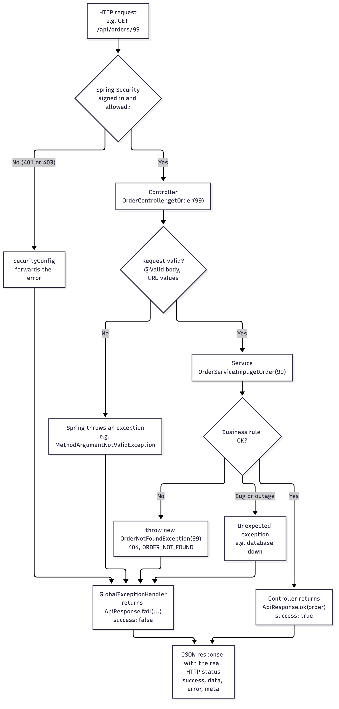
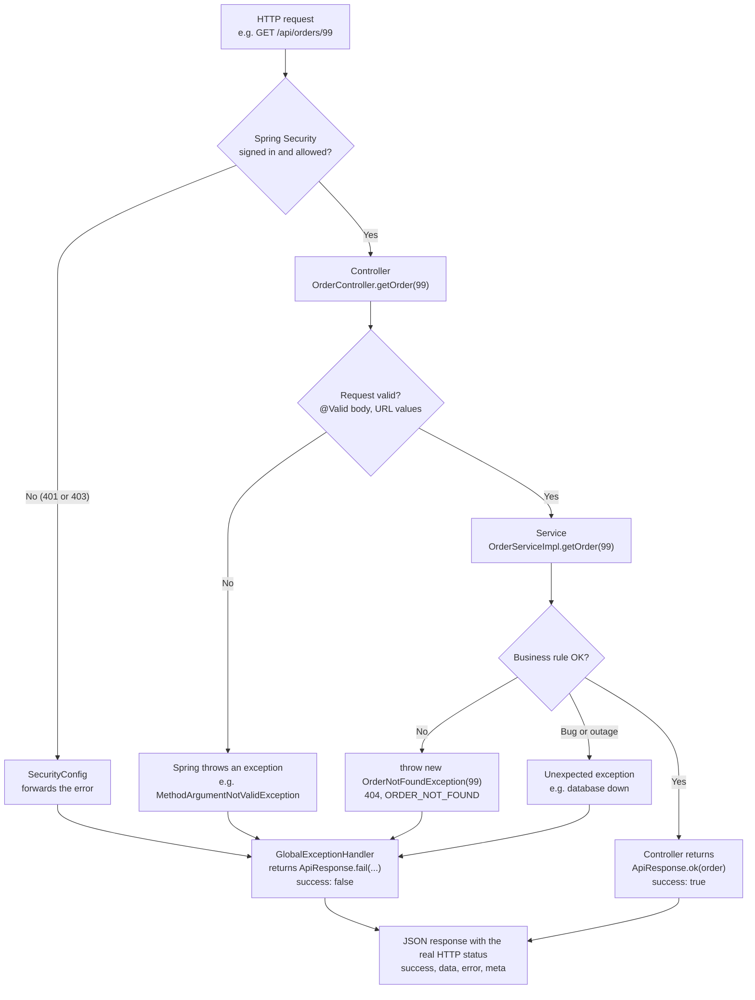
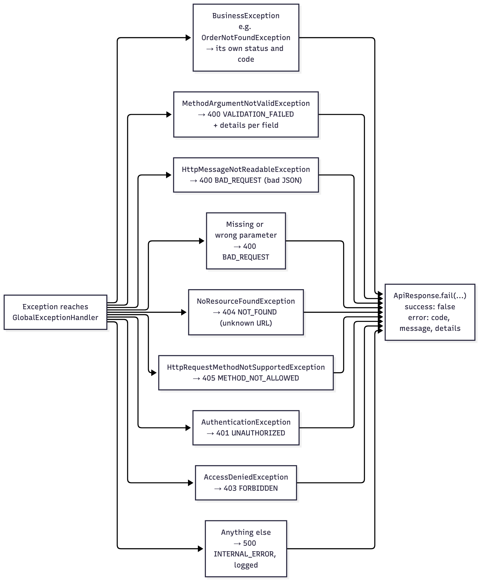
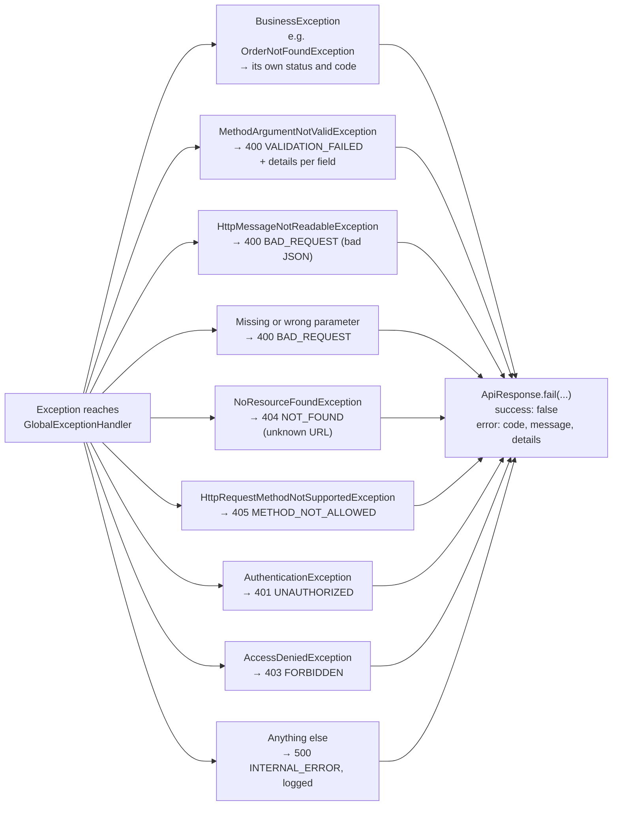

# Error Handling

How the Astronity POS backend reports errors. Every error, whatever caused it, has the same shape as a successful response, so the Angular app handles all of them in one place.

## The format

An error is an [ApiResponse](../api-response/README.md#the-envelope) with `success: false`, `data: null` and `error` filled in:

| Field | Meaning |
|---|---|
| `error.code` | **What the frontend checks.** Upper case, never changes once released |
| `error.message` | A sentence a person can read. Never internal details such as SQL or stack traces |
| `error.details` | One `{ field, message }` per invalid field on `VALIDATION_FAILED`; empty otherwise |

The HTTP status is always the real one (404, 409, 500 …), never 200. Examples: [get-order.404.json](../api-response/examples/orders/get-order.404.json), [create-order.400.json](../api-response/examples/orders/create-order.400.json) and [examples/errors/](../api-response/examples/errors/).

## How it works



Services and controllers never build an error response. They only **throw**. Every exception, wherever it happens, goes to `GlobalExceptionHandler`, which returns `ApiResponse.fail(...)`.

`GlobalExceptionHandler` is used automatically: Spring finds it at startup because of `@RestControllerAdvice`. Nothing has to call it.

<details>
<summary>Mermaid source</summary>



</details>

## Which method handles what



Spring picks the method whose exception type matches best, so `OrderNotFoundException` goes to `handleBusiness`, and only exceptions that match nothing else reach `handleOther`.

| Cause | Status | `error.code` | Method |
|---|---|---|---|
| A feature exception, e.g. `OrderNotFoundException` | from the exception | from the exception | `handleBusiness` |
| `@Valid` failed on a request body | 400 | `VALIDATION_FAILED` | `handleValidation` |
| Broken or missing JSON body | 400 | `BAD_REQUEST` | `handleBadJson` |
| Missing or wrong query/path value, e.g. `?status=nope` | 400 | `BAD_REQUEST` | `handleBadParameter` |
| Unknown URL | 404 | `NOT_FOUND` | `handleUnknownUrl` |
| Wrong HTTP method | 405 | `METHOD_NOT_ALLOWED` | `handleWrongMethod` |
| Not signed in | 401 | `UNAUTHORIZED` | `handleNotSignedIn` |
| Signed in, no permission | 403 | `FORBIDDEN` | `handleForbidden` |
| Another Spring request error, e.g. wrong content type | Spring's own, e.g. 415 | `REQUEST_FAILED` | `handleOther` |
| Anything unexpected (a bug, the database is down) | 500 | `INTERNAL_ERROR` | `handleOther`, which logs it and sends only "Something went wrong" |

The 401 and 403 happen in Spring Security, before any controller runs. `SecurityConfig` forwards them to `GlobalExceptionHandler`, so they get the same shape.

<details>
<summary>Mermaid source</summary>



</details>

## Files

Copy each Java file into the backend at the same package path under `backend/src/main/java/com/astronity/pos/`.

```
error-handling/
├── images/                               ← the two diagrams, .mmd source and .png (docs only)
├── common/
│   ├── exception/
│   │   ├── BusinessException.java        ← base class: status + code + message
│   │   ├── NotFoundException.java        ← base class for 404s
│   │   └── GlobalExceptionHandler.java   ← every exception → ApiResponse.fail(...)
│   └── config/
│       └── SecurityConfig.java           ← 401/403 to the handler, and the PasswordEncoder bean
├── auth/exception/                       ← example feature exceptions
│   ├── InvalidCredentialsException.java      401  INVALID_CREDENTIALS
│   ├── AccountDisabledException.java         403  ACCOUNT_DISABLED
│   └── AccountLockedException.java           423  ACCOUNT_LOCKED
└── order/exception/
    ├── OrderNotFoundException.java           404  ORDER_NOT_FOUND
    └── OrderStateException.java              409  ORDER_STATE_INVALID
```

`GlobalExceptionHandler` uses `ApiResponse`, `ApiError` and `Meta` from [api-response/common/response/](../api-response/README.md#files), so copy those too.

The backend also needs `spring-boot-starter-validation` for `@Valid`:

```xml
<dependency>
    <groupId>org.springframework.boot</groupId>
    <artifactId>spring-boot-starter-validation</artifactId>
</dependency>
```

## Adding an exception

1. Create it in the feature's `exception/` package.
2. Extend `NotFoundException` for "doesn't exist", or `BusinessException` with a status for anything else.
3. Give it a new `code`. Nothing else changes: `GlobalExceptionHandler` already handles it.

```java
package com.astronity.pos.menu.exception;

public class ProductOutOfStockException extends BusinessException {

    public ProductOutOfStockException(String productName) {
        super(HttpStatus.CONFLICT, "PRODUCT_OUT_OF_STOCK", productName + " is out of stock");
    }
}
```

Then throw it from the service:

```java
if (product.isOutOfStock()) {
    throw new ProductOutOfStockException(product.getName());
}
```

Which status to use:

| Status | When | Example |
|---|---|---|
| 400 | The request itself is wrong | Quantity is negative |
| 401 | Not signed in, or the sign-in failed | Wrong password |
| 403 | Signed in but not allowed | Account disabled, cashier opening reports |
| 404 | The record doesn't exist | Order 42 |
| 409 | The record exists, but its state doesn't allow this | Voiding a paid order, product out of stock |
| 423 | Locked for a while | Too many wrong passwords |

## Rules

- **Exceptions are unchecked.** `BusinessException` extends `RuntimeException`, so methods need no `throws` and `@Transactional` rolls back. List them with `@throws` in the service interface's Javadoc instead.
- **Throw from services, not controllers.** Controllers never catch these exceptions; `GlobalExceptionHandler` does.
- **One code per meaning, forever.** The frontend matches on `error.code`, so a released code is never renamed or reused. `error.message` may be reworded at any time.
- **Never put internal details in `error.message`.** No SQL, stack traces, IDs of other stores or other customers' data. Unexpected errors are logged on the server and the client only sees "Something went wrong".
- **One constructor per exception**, with a fixed message. In particular, `InvalidCredentialsException` must not take a custom message, so "unknown user" and "wrong password" always look the same.

## Testing

A service test checks the exception:

```java
assertThatThrownBy(() -> orderService.voidOrder(42L))
        .isInstanceOf(OrderNotFoundException.class);
```

A controller test checks the response. `@WebMvcTest` loads `GlobalExceptionHandler` automatically:

```java
when(orderService.getOrder(42L)).thenThrow(new OrderNotFoundException(42L));

mockMvc.perform(get("/api/orders/42"))
        .andExpect(status().isNotFound())
        .andExpect(jsonPath("$.success").value(false))
        .andExpect(jsonPath("$.error.code").value("ORDER_NOT_FOUND"));
```

## Related docs

- [Project structure](../project-structure/README.md): where `exception/` sits inside a feature
- [Staff login and permissions](../../pos-docs/flowcharts/12-staff-login-and-permissions.md): when the auth exceptions are thrown
