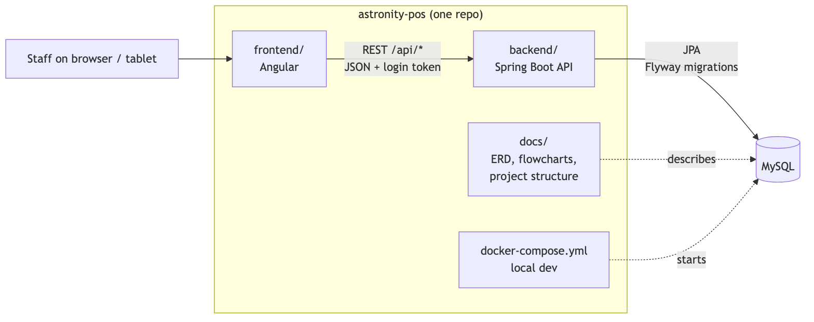
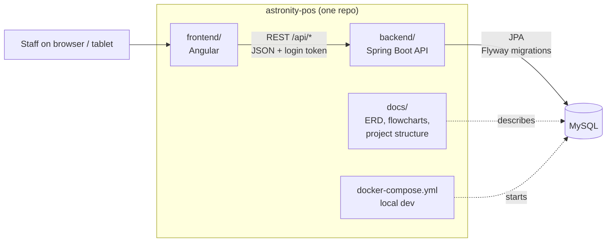
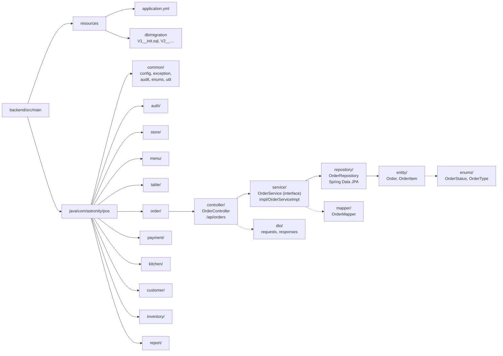
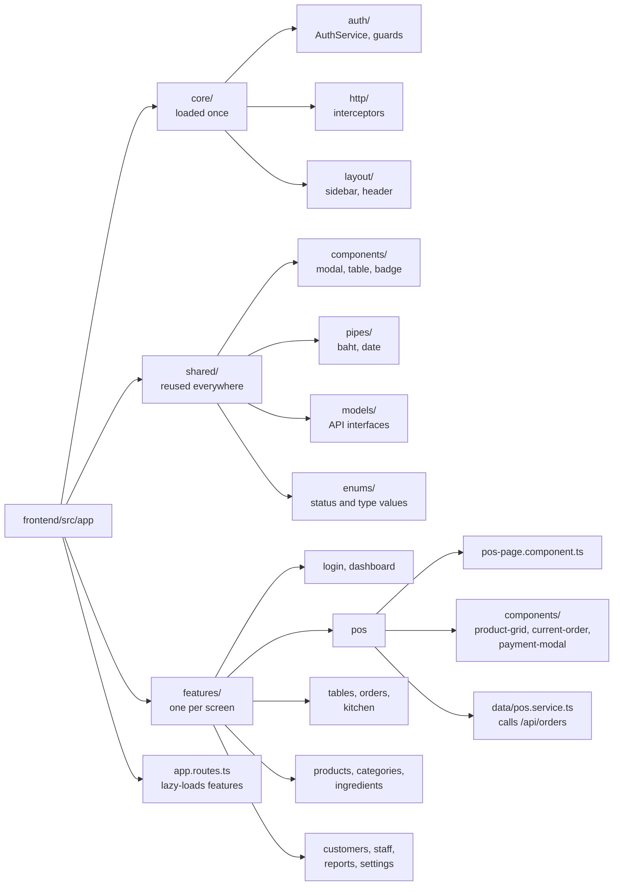

# Project Structure

How the Astronity POS code is organised: one repository holding the Spring Boot backend, the Angular frontend and these docs. It covers both the restaurant and the coffee shop.

## Repository



```
astronity-pos/
├── backend/            ← Java Spring Boot API
├── frontend/           ← Angular app
├── docs/               ← ERD, flowcharts, project structure
├── docker-compose.yml  ← database + backend + frontend for local dev
└── README.md
```

**Why one repository:** a single pull request can change the database migration, the API, the screen and the ERD together, so they never drift apart. This suits a small team.

**Database:** the ERD uses MySQL types (`AUTOINCREMENT`, `ENUM`, `ON UPDATE CURRENT_TIMESTAMP`), so MySQL is assumed here.

<details>
<summary>Mermaid source</summary>



</details>

## Backend: Spring Boot


Code is grouped by **feature**, using the same domains as the [ERD](../../pos-docs/erd.md), not by layer. Everything about orders lives in `order/`, instead of being spread across `controllers/`, `services/` and `repositories/`.

```
backend/
├── pom.xml
└── src/
    ├── main/
    │   ├── java/com/astronity/pos/
    │   │   ├── PosApplication.java
    │   │   ├── common/                 ← shared by all features
    │   │   │   ├── config/             (Security, CORS, Jackson)
    │   │   │   ├── exception/          (GlobalExceptionHandler, BusinessException, NotFoundException)
    │   │   │   ├── response/           (ApiResponse envelope, ApiError, Meta, Pagination)
    │   │   │   ├── audit/              (AuditLog, AuditLogService)
    │   │   │   ├── enums/              (DbEnum interface, DbEnumConverter base)
    │   │   │   └── util/               (NumberGenerator for ORD-, KOT-, INV-)
    │   │   ├── auth/                   ← users, roles, permissions, role_permissions, user_roles, login
    │   │   ├── store/                  ← stores, printers, payment_methods (Settings)
    │   │   ├── menu/                   ← categories, products, modifiers, product_modifiers
    │   │   ├── table/                  ← dining_tables, merge and transfer
    │   │   ├── order/                  ← orders, order_items, order_item_modifiers, order_tables
    │   │   ├── payment/                ← payments, receipts
    │   │   ├── kitchen/                ← stations, kitchen_tickets, kitchen_ticket_items
    │   │   ├── customer/               ← customers
    │   │   ├── inventory/              ← ingredients, recipe_items, stock_movements
    │   │   └── report/                 ← dashboard and reports (read-only queries)
    │   └── resources/
    │       ├── application.yml
    │       ├── application-dev.yml
    │       └── db/migration/           ← Flyway: V1__init.sql, V2__…
    └── test/
        ├── java/com/astronity/pos/     ← same feature folders as main (see Tests)
        └── resources/
            └── application-test.yml
```

### Inside a feature

Every feature has the same sub-packages, one per layer. Example, `order/`:

```
order/
├── controller/
│   └── OrderController.java        ← REST endpoints: /api/orders
├── service/
│   ├── OrderService.java           ← interface: what orders can do
│   └── impl/
│       └── OrderServiceImpl.java   ← @Service: business rules (send to kitchen, pay, void)
├── repository/
│   └── OrderRepository.java        ← Spring Data JPA
├── entity/
│   ├── Order.java                  ← JPA entity → orders table
│   ├── OrderItem.java
│   └── OrderItemModifier.java
├── enums/
│   ├── OrderStatus.java            ← open | served | paid | completed | void
│   ├── OrderType.java              ← dine_in | takeaway | delivery
│   └── OrderItemStatus.java        ← pending | sent | void
├── dto/
│   ├── CreateOrderRequest.java
│   └── OrderResponse.java
├── exception/
│   ├── OrderNotFoundException.java ← extends NotFoundException → 404
│   └── OrderStateException.java    ← extends BusinessException → 409, e.g. voiding a paid order
└── mapper/
    └── OrderMapper.java            ← entity → DTO (plain class)
```

A feature only adds the sub-packages it needs; `report/`, for example, has no `entity/`.

**Each feature owns its exceptions** in `exception/`. They extend a base class from `common/exception/` (`NotFoundException` or `BusinessException`), and `GlobalExceptionHandler` maps them to an HTTP status and one JSON error format, so a new exception needs no handler code. The classes and the format are in [Error handling](../error-handling/README.md).

A request flows **Controller → Service → Repository → Entity**. Controllers only accept and return DTOs, never entities. Business rules (stock deduction, numbering, permissions) live in services.

**Services are an interface plus an implementation** (Dependency Inversion). Controllers and other features inject `OrderService`, never `OrderServiceImpl`, so callers depend on what a service does, not how. The `impl/` package holds the only class annotated `@Service`.

### Enums

Every fixed list of values in the ERD (statuses, types, methods) is a Java enum in the `enums/` package of the feature that owns the table:

| Feature | Enum | Column | Values |
|---|---|---|---|
| `auth/` | `UserStatus` | `users.status` | active, disabled |
| `table/` | `TableStatus` | `dining_tables.status` | available, occupied, reserved, billing |
| `order/` | `OrderType` | `orders.order_type` | dine_in, takeaway, delivery |
| `order/` | `OrderStatus` | `orders.status` | open, served, paid, completed, void |
| `order/` | `OrderItemStatus` | `order_items.status` | pending, sent, void |
| `kitchen/` | `StationType` | `stations.type` | kitchen, bar |
| `kitchen/` | `KitchenTicketStatus` | `kitchen_tickets.status` | queued, preparing, ready, served |
| `payment/` | `PaymentMethod` | `payments.method` | cash, card, promptpay |
| `inventory/` | `StockMovementType` | `stock_movements.type` | stock_in, sale, adjustment |

The database stores lowercase values (`dine_in`), while Java constants are uppercase (`DINE_IN`). Each enum keeps its database value and implements `DbEnum` from `common/enums/`:

```java
public enum OrderType implements DbEnum {
    DINE_IN("dine_in"), TAKEAWAY("takeaway"), DELIVERY("delivery");

    private final String value;
    OrderType(String value) { this.value = value; }

    @JsonValue                       // API sends "dine_in", same as the database
    public String getValue() { return value; }

    @Converter(autoApply = true)     // entity field ↔ column, no @Enumerated needed
    public static class JpaConverter extends DbEnumConverter<OrderType> {
        public JpaConverter() { super(OrderType.class); }
    }
}
```

`DbEnum`, `DbEnumConverter` and the `WebConfig` that makes `?status=open` work in URLs are in [Enum handling](../enum-handling/README.md).

Enums and exceptions from another feature may be used directly (for example `payment` reading `OrderStatus` or catching `OrderStateException`); unlike `impl`, `repository` and `entity`, they are part of a feature's public contract.

### Tests

The team works test-first (TDD): write a failing test, make it pass, then tidy up. Tests follow the main folder structure: a test sits in the same package as the class it tests. Example, `order/`:

```
backend/src/test/java/com/astronity/pos/
├── ArchitectureTest.java           ← ArchUnit: checks the cross-feature rule below
├── TestcontainersConfiguration.java ← starts the MySQL container for database tests
└── order/
    ├── controller/
    │   └── OrderControllerTest.java        ← @WebMvcTest, OrderService mocked
    ├── service/
    │   └── impl/
    │       ├── OrderServiceImplTest.java       ← JUnit + Mockito, no Spring
    │       ├── OrderCalculationTest.java       ← totals, tax, discounts
    │       ├── OrderValidationTest.java        ← invalid requests are rejected
    │       └── OrderStateTransitionTest.java   ← open → served → paid → completed, and void
    ├── fixture/
    │   └── OrderTestDataFactory.java       ← builds valid orders and requests for tests
    └── OrderIntegrationTest.java           ← full flow through HTTP and a real database
```

| Test | Checks | Group |
|---|---|---|
| `OrderServiceImplTest` | Business rules, with repositories and other services mocked | fast |
| `OrderCalculationTest` | Totals, tax and discounts | fast |
| `OrderValidationTest` | Invalid requests are rejected | fast |
| `OrderStateTransitionTest` | Allowed and blocked status changes (open → served → paid → completed, void) | fast |
| `OrderControllerTest` | URLs, validation, status codes, JSON shape | fast |
| `OrderIntegrationTest` | A whole flow, from request to MySQL | slow |
| `ArchitectureTest` | Features only call each other's `service` interfaces | fast |

`OrderTestDataFactory` is not a test; it builds valid orders and requests for the tests above.

#### Running one file

In IntelliJ, click the green ▶ next to the class name (or a single method), or put the cursor inside it and press `⌃⇧R`. `⌃R` runs the last one again.

From the terminal:

| To run | Command |
|---|---|
| One fast test file | `./mvnw test -Dtest=OrderServiceImplTest` |
| One test method | `./mvnw test -Dtest=OrderServiceImplTest#voidOrder_rejectsPaidOrder` |
| One integration test file | `./mvnw verify -Dit.test=OrderIntegrationTest -Dtest=none -Dsurefire.failIfNoSpecifiedTests=false` |
| All fast tests | `./mvnw test` |
| Everything, fast and slow | `./mvnw verify` |

The integration command is long because `verify` runs the fast tests first; `-Dtest=none` and the setting after it skip them.

#### Fast and slow tests

- **Start with `OrderServiceImplTest`.** Business rules (stock deduction, numbering, void) live in the service, and these tests run in milliseconds because they don't start Spring. This is where the red-green loop happens.
- **Fast tests run on `mvn test`, `*IntegrationTest` runs on `mvn verify`.** Fast tests are run constantly while coding; integration tests need MySQL, so they run before pushing and in CI. By default Maven would put every name ending in `Test` in the fast group, so the backend's `pom.xml` moves `*IntegrationTest` to the slow group:

  ```xml
  <plugin>
      <groupId>org.apache.maven.plugins</groupId>
      <artifactId>maven-surefire-plugin</artifactId>
      <configuration>
          <excludes>
              <exclude>**/*IntegrationTest.java</exclude>
              <exclude>**/*$*</exclude>
          </excludes>
      </configuration>
  </plugin>
  <plugin>
      <groupId>org.apache.maven.plugins</groupId>
      <artifactId>maven-failsafe-plugin</artifactId>
      <configuration>
          <includes>
              <include>**/*IntegrationTest.java</include>
          </includes>
      </configuration>
  </plugin>
  ```

- **Database tests use real MySQL through Testcontainers, not H2.** The migrations use MySQL-only types (`ENUM`, `ON UPDATE CURRENT_TIMESTAMP`), so H2 would fail or behave differently. `TestcontainersConfiguration` starts the container and Flyway runs the real migrations against it.
- **Each [flowchart](../../pos-docs/flowcharts/README.md) becomes one `*IntegrationTest`.** For example, `04-payment.md` becomes `PaymentIntegrationTest`, so the flowcharts are also the list of flows to test.
- **A feature PR includes its tests.** A bug fix starts with a failing test that reproduces the bug.

### Rules

- **Database changes go through Flyway** in `db/migration/`. Never change the database by hand.
- **Every migration PR also updates [docs/erd.md](../../pos-docs/erd.md)** and its images.
- **Never use `@Enumerated(EnumType.ORDINAL)`**, and don't rely on `EnumType.STRING` either: it writes `DINE_IN`, which doesn't match the lowercase database values. Use the enum's `JpaConverter`. Adding a value to an enum needs a migration too when the column is a MySQL `ENUM`.
- **One feature may call another feature's `service` interface**, never its `impl`, `repository` or `entity` directly. For example, `payment` calls `InventoryService` to deduct stock. Sub-packages make these classes `public`, so this rule isn't enforced by Java; `ArchitectureTest` (ArchUnit) checks it.

<details>
<summary>Mermaid source</summary>



</details>

## Frontend: Angular


Standalone components, with one folder per **screen in the UI kit**, so a developer can find the code from what they see in the app.

```
frontend/
├── angular.json
├── package.json
├── e2e/                         ← Playwright: whole flows in a real browser
└── src/
    ├── main.ts
    ├── environments/            ← apiUrl per environment
    ├── styles/                  ← global styles (from pos-ui-kit css)
    └── app/
        ├── app.config.ts
        ├── app.routes.ts        ← lazy-loads each feature
        ├── core/                ← loaded once
        │   ├── auth/            (AuthService, authGuard, permissionGuard)
        │   ├── http/            (auth and error interceptors)
        │   └── layout/          (sidebar, header, shell)
        ├── shared/              ← reused everywhere
        │   ├── components/      (modal, table, badge, confirm dialog)
        │   ├── pipes/           (baht currency, date)
        │   ├── models/          (TypeScript interfaces matching API DTOs)
        │   └── enums/           (OrderStatus, OrderType, PaymentMethod… matching backend enums)
        └── features/            ← one folder per screen
            ├── login/
            ├── dashboard/
            ├── pos/
            ├── tables/
            ├── orders/
            ├── kitchen/         (Kitchen / Barista Display)
            ├── products/
            ├── categories/
            ├── ingredients/
            ├── customers/
            ├── staff/
            ├── reports/
            └── settings/
```

### Inside a feature

Example, `pos/`:

```
pos/
├── pos.routes.ts
├── pos-page.component.ts        ← the screen
├── components/                  (product-grid, current-order, payment-modal, modifier-modal)
└── data/
    └── pos.service.ts           ← calls /api/orders, /api/products
```

### Tests

A spec file sits next to the file it tests (the Angular convention), not in a separate test folder:

```
pos/
├── pos-page.component.ts
├── pos-page.component.spec.ts
├── components/
│   ├── payment-modal.component.ts
│   └── payment-modal.component.spec.ts
└── data/
    ├── pos.service.ts
    └── pos.service.spec.ts      ← HttpTestingController, no real API

frontend/e2e/
├── dine-in-order.spec.ts        ← one spec per flowchart
└── payment.spec.ts
```

- **Write the spec first**, the same as on the backend. Start with `data/*.service.spec.ts` and any component that holds logic (totals, split bill, modifier choices).
- **Unit specs never call the real API.** Services use `HttpTestingController`; components get a fake service.
- **`e2e/` covers whole flows**, one spec per [flowchart](../../pos-docs/flowcharts/README.md), run against the backend started by `docker-compose.yml`.

### Rules

- **Features don't import from each other.** Anything two features need goes in `shared/`.
- **`core/` is for app-wide singletons** (auth, interceptors, layout), not for screen code.
- **Models in `shared/models/` mirror the backend DTOs**, not the database tables.
- **Enums in `shared/enums/` mirror the backend enums**, using the API values: `export type OrderType = 'dine_in' | 'takeaway' | 'delivery';`. Screen labels ("Dine-in", "Send to Bar") are mapped in the component or a pipe, not stored in the enum.

<details>
<summary>Mermaid source</summary>



</details>

## Restaurant and coffee shop

There is **one backend and one frontend**, not two copies. There is no business-type flag on the store; the labels come from the store's `stations`:

| | Restaurant | Coffee shop |
|---|---|---|
| Display name | Kitchen Display | Barista Display |
| POS button | Send to Kitchen | Send to Bar |
| Stations | Kitchen + Bar | Bar |

The frontend loads the store's stations after login. If any station has `type = kitchen`, it shows the restaurant labels; if there are only `bar` stations, it shows the coffee shop labels. A coffee shop that adds a kitchen station gets the kitchen labels automatically. This matches the ERD's "shared tables, differences as data" decision.

`pos-ui-kit` keeps separate `restaurant/` and `coffee/` folders, but treat it as the design reference only. Build each screen once in Angular.

## Related docs

- [ERD](../../pos-docs/erd.md): every table and column
- [Flowcharts](../../pos-docs/flowcharts/README.md): step-by-step business flows
